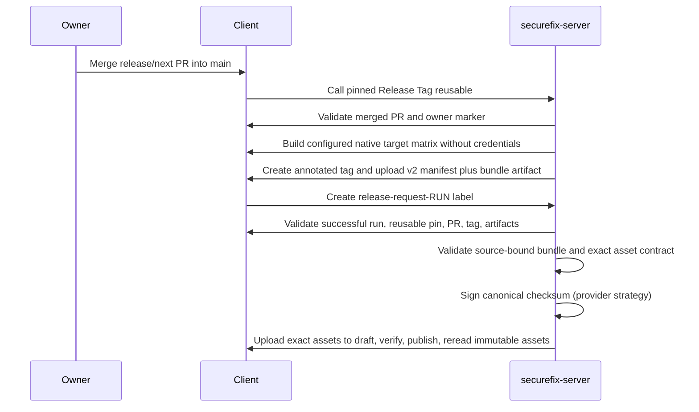

# Client releases

Release preparation runs in the client repository. The trusted Rust CLI and all privileged release operations run from this repository. Client code never receives the provider signing key or the publishing token.

## Flow and trust boundaries



The active control revision supplies the policy used for privileged effects. The source Release Tag run must be successful, originate in the exact client repository, expose a confined caller workflow path, and reference the runtime source selected by the active descriptor. For PR runs, the run SHA must match the associated PR head SHA; the server reads the caller workflow from the PR's base SHA, which must be on the default branch, and requires its reusable call to pin the active runtime source. Owner-dispatched retries read the workflow at the run SHA and require that SHA on the default branch. The v2 manifest binds its run ID/attempt, full control identity, runtime source, release PR, merge commit, tag, and configured release-bundle artifact ID. The PR must be merged `release/next` → `main` by the server bot. The server also reads `.release-version` from the merged commit and requires it to match the tag. Sensitive owner authorization is represented by a server-authored marker bound to the exact PR head SHA and full control identity.

## Development instance release path

The new `reusable-server-release.yml` path reads the Server instance's protected
TOML. It does not use `control/active.json` or the binary's bundled policy.
The Server wrapper pin and the Client Release Tag signer pin are independent.
The source manifest must identify the actual accepted Client signer, exact
producer run and attempt, merged release PR, and annotated tag. The plan binds
the protected configuration and Server deployment authority. Signing and
publication reject changes to those identities, the approved PR head, or the
accepted package.

Client package source and release storage are separate identities. Normal
admission requires formal releases in `[acceptable_clients]`'s version range.
Only an explicitly configured `scratch_package_repository` enables the existing
prerelease verifier. The publisher requalifies that exact pinned Action manifest
and package before scratch writes. A scratch destination never becomes the OSS
distributor. Acquisition does not authorize publication.

Draft inspection uses a single-Client token with Contents write permission in a
read-only Rust API context. In the isolated publication job, draft and asset
reads use the publication token; source, PR, and provenance reads use the reader
token. Neither token reaches Client build hooks or the signing job. Request label
cleanup can delete only the authenticated event's label in the current protected
Server deployment. These candidate connections require scratch qualification
before deployment; the existing production path above remains active meanwhile.

## Runtime distribution

After explicit control activation and distribution dispatch, the distributor opens or updates a pull request authored by the Server App for the canonical managed caller-workflow files. It validates the configured branch, fresh PR identity and head, and exact managed-file changes. The PR remains reviewable and follows the normal review and check rules; distribution does not merge it or bypass those rules. Caller pins change only after control activation, not after ordinary publication.

### Reviewing a caller migration

The previous caller pin cannot send normal requests after activation. Complete its
generated migration through `merge-caller-migration.yml` on server `main`. This
separate owner dispatch loads the active published controller and shares the
`securefix-control` mutation lane. It accepts only a policy-registered caller's
canonical Server App PR, signed migration history, and exact generated workflow
bytes for the active runtime. It never executes caller code.

1. Inspect the generated diff and required Actions `status-check`. Submit an owner
   `APPROVED` review of the exact PR head with the marker
   `<!-- securefix:control-review:<full-active-control-id> -->`. The review must be
   later than the active descriptor's activation commit.
2. Post separate owner `/approve` and `/merge` comments, in that order, after the
   review. Commands must be unedited, less than one hour old, and unused by a
   previous migration dispatch.
3. Dispatch `merge-caller-migration.yml` with `repository`, `pull_request`,
   `expected_head_sha`, `control_id`, `approve_comment_id`, `merge_comment_id`,
   and the active descriptor's `publisher_run_id`.

The controller validates the dispatch's repository, signed current main, owner,
first attempt and fixed workflow before it mints caller credentials. It records
the normal head/control-bound owner receipts and policy check only after full PR
authorization. It requires required CI and the current-head control-bound owner
review before minting the merge token. Immediately before expected-head squash
merge it repeats those checks, command timestamps, canonical files, base SHA,
control identity and producer validation. Changed inputs, commands, heads, bases
or control generations fail closed. It then verifies the resulting default SHA
and all managed file bytes. A failed consumed dispatch requires fresh commands.

This workflow has no Administration permission or repository-settings preflight.
After the migration, the caller's normal request workflows use the active pin.

## Provider build and publication

The build job compiles the fixed provider target matrix from the validated merge commit. It has no app token or signing key. The signer receives the already-built release bundle and a read-only server token for current-runtime and artifact provenance checks; it uses public client API data for release validation and has no client repository credential. It verifies exact filenames, archive structure, and hashes, generates canonical SHA256SUMS, and verifies the signature against the configured signing fingerprint before packaging it. Preflight uses a token scoped to the single client repository with contents-write permission because GitHub requires push access to read unpublished drafts; its Rust API connection permits reads only. If a retry finds a signature already uploaded to the same draft release, preflight downloads that exact asset, binds its digest and release ID into the short-lived plan, and the signer reuses those bytes only after checking the digest and verifying the signature over the regenerated checksum file. This preserves the signature bytes across partial uploads even though a fresh OpenPGP signature can differ. Unexpected, duplicate, mismatched, oversized, or unverifiable draft assets stop the run for inspection. The signer never loads client GoReleaser config, hooks, scripts, or executables. The publisher receives the signed bytes and a client contents-write token, but no GPG key. Existing published assets are never overwritten.

## Client policy and strategies

[`policy.json`](../policy.json) is the exact allowlist and strategy source. Supported strategies are `github-release` and `terraform-provider`; no client-provided release configuration is evaluated. A policy change requires review and a merge to this repository.

For a `github-release` repository with an empty `native_binaries` list, Release Tag retains its existing zero-asset behavior. A configured native matrix is built from the validated release merge commit before the tag manifest and server request are created. The Linux Rust controller resolves the allowed target/runner matrix; each build job checks out that exact merge commit and runs only the fixed `cargo build --locked --release --bin <repository> --target <target>` command on the configured GitHub-hosted runner. The job reads `.release-version` from the checked-out commit, executes the resulting binary's `--version` on that runner, and uploads the binary with runner and version evidence. Those build jobs receive no app token or signing key, and checkout credentials are disabled. The Linux Rust assembler checks the current run and attempt, exact artifact names and target set, and binds each artifact's configured runner, actual runner OS/CPU, executed version output, filename, size, and digest to the source run, release PR, and package version. For ordinary releases the package version and release tag version come from the same `.release-version` value; the scratch rehearsal uses a unique prerelease tag while keeping the binary version bound to the pinned Client source. Preflight validates the artifact's source run and exact target set; the publisher rechecks local bytes, uploads only missing exact-name, digest, and size assets to the draft, verifies the complete set before publishing, and rereads the published immutable release and every asset digest. It never overwrites or mutates a published release.

For a merged-PR Release Tag run, the Actions API head identifies the approved PR head while the execution and attestation source context identifies its exact merge commit. The resolver supplies the verified API head to the credential-free native builders; assembly and attestation validation bind both identities separately. A manually dispatched retry uses its verified run head as the execution context. Release approval validation ignores non-transition timeline records, requires the configured Server App's exact merge and close events, and permits its subsequent automatic release-branch deletion. Other post-command invalidating transitions remain rejected.

The `herdr-linear-agent` package uses four native targets: `aarch64-apple-darwin`, `x86_64-apple-darwin`, `aarch64-unknown-linux-musl`, and `x86_64-unknown-linux-musl`. Published filenames are `<repository>-<target>`. The existing client-side `release-assets.yml` workflow builds and uploads after `release.published`; it must be retired or converted as part of caller migration before this path is enabled because immutable releases reject late asset uploads.

For `terraform-provider`, the server builds 13 ZIP assets using Go 1.26.5 and fixed Go build flags/targets. Each ZIP contains exactly `CHANGELOG.md`, `LICENSE`, `README.md`, and `${project}_v${version}` (with `.exe` on Windows); this matches the existing Sigma provider archive contract. Asset names are `${project}_${version}_${os}_${arch}.zip`, and the manifest is `${project}_${version}_manifest.json`. The server generates `${project}_${version}_SHA256SUMS` for all ZIPs and the manifest and its detached `.sig`. These names and archive contents are part of the Terraform Registry compatibility contract.

## Securefix CLI package publication

The Server's own `securefix-linux-x86_64` package has a separate producer and
publisher. The owner-dispatched `native-package-build.yml` runs on the selected
source commit with no publication credential. It tests and builds the CLI,
uploads only the raw executable, and attests that exact file. The protected-main
`publish-native-package.yml` builds its Rust publisher host from the workflow
revision; the publisher treats the producer artifact as data and never executes
it with a write token.

Dispatch the publisher with the exact producer run ID and `channel`. The
source revision carries a strict schema-v2 build manifest at
`.github/actions/load-package/source-package.json`; it fixes the producer
workflow, publisher workflow, package version, size limit, and asset name. Rust
validates that manifest against `Cargo.toml`, the producer run and attempt, the
exact artifact and attestation, and the actual owner-dispatched publisher run.
The release body records the source-manifest digest, source revision, producer
and publisher run identities, tag, and exact asset name, size, and digest.

The package loader Action has a separate strict schema-v3 `package.json` at its
pinned Action revision. It maps that Action revision to the executable's source
revision, the source-manifest path and digest, and the immutable release and
asset record. Rust derives the local Action references from the authenticated
Client producer workflow and rejects missing or mixed mappings; the Action
revision may differ from the executable source revision. The caller passes only
the token to the loader, which verifies the mapping before downloading the
executable. The publisher rechecks the protected destination branch before each
write, uploads the single `securefix-linux-x86_64` asset to a draft, publishes
it, then rereads the release and asset and requires immutable state and matching
bytes and digests.

`stable` targets the Server repository and uses a canonical stable SemVer tag.
`scratch` targets only the repository fixed in the protected publisher workflow
and uses a prerelease tag. Neither destination is accepted from dispatch input.
The scratch token is scoped to the test repository; the stable token is scoped
to the Server repository. The build and attestation jobs receive no release
write token, and the publisher does not inspect repository settings or request
Administration permission.

## Client wrappers

Pin each reusable to a full commit SHA and give its caller the minimum `permissions` shown here:

| Reusable | Caller permissions |
| --- | --- |
| `reusable-release-pr.yml` | `actions: read`, `contents: read`, `attestations: read`, `pull-requests: read` |
| `reusable-release-pr-sync.yml` | `actions: read`, `contents: read`, `attestations: read`, `pull-requests: write` |
| `reusable-release-tag.yml` | `actions: read`, `contents: write`, `attestations: read`, `pull-requests: read`, `issues: write` |

A release PR wrapper passes `SECUREFIX_CLIENT_PRIVATE_KEY` and may provide an explicit version. The Rust CLI updates `.release-version`, `CHANGELOG.md`, and supported root package version metadata before Securefix opens or updates `release/next`. When reusing an existing Server App-owned release PR, the apply step also synchronizes its title and body from the validated artifact options, including on idempotent retries. Native metadata sync uses the protected external Server configuration and the authenticated Client workflow/package mapping. Its Client repository token may PATCH only the validated title and body of the exact Server-owned release PR; current run, release-branch head, caller epoch and Server authority are rechecked immediately before that write. A release-request label existence read does not require a POST payload; label creation retains its exact run-bound payload and pre-write Server authority check.

```yaml
name: Release PR
on:
  push:
    branches: [main]
  workflow_dispatch:
    inputs:
      version:
        description: Explicit version without v; empty uses git-cliff
        required: false
        type: string
permissions: {}
jobs:
  prepare:
    permissions:
      actions: read
      contents: read
      attestations: read
      pull-requests: read
    uses: civitaspo/securefix-server/.github/workflows/reusable-release-pr.yml@<full-commit-sha>
    with:
      version: ${{ inputs.version }}
    secrets:
      SECUREFIX_CLIENT_PRIVATE_KEY: ${{ secrets.SECUREFIX_CLIENT_PRIVATE_KEY }}
```

The Release Tag reusable runs after a merged release PR. It accepts no SHA or tag override. For a retry, dispatch the client repository's wrapper with the already-merged `release_pr_number`; the owner, merge state, base/head branches, server-bot merger, owner marker, and exact source revision are checked again. A wrapper can expose this input as follows:

```yaml
name: Release Tag
on:
  pull_request:
    types: [closed]
  workflow_dispatch:
    inputs:
      release_pr_number:
        description: Merged release/next PR to retry
        required: true
        type: number
permissions: {}
concurrency:
  group: release-tag-${{ github.event.pull_request.number || inputs.release_pr_number }}
  cancel-in-progress: false
jobs:
  tag:
    if: github.event_name == 'workflow_dispatch' || (github.event.pull_request.merged && github.event.pull_request.head.ref == 'release/next' && github.event.pull_request.head.repo.full_name == github.repository)
    permissions:
      actions: read
      contents: write
      attestations: read
      pull-requests: read
      issues: write
    uses: civitaspo/securefix-server/.github/workflows/reusable-release-tag.yml@<full-commit-sha>
    with:
      release_pr_number: ${{ inputs.release_pr_number }}
    secrets:
      SECUREFIX_CLIENT_PRIVATE_KEY: ${{ secrets.SECUREFIX_CLIENT_PRIVATE_KEY }}
```

The client app private key is used only to create a short-lived, server-repository issues-write token for the request label. The server creates a separate, repository-scoped client token for source/artifact reads and publication. Do not pass a client token or private key to the build job.

## Request label protocol

The label name is `release-request-<source_run_id>` and its description is exactly `<owner>/<repo>/<source_run_id>`. It is a locator only: the server does not trust a tag, SHA, strategy, or artifact ID from the label. Those values come from the source run and manifest after the server verifies the run and its artifacts.

The referenced source run must be named `Release Tag`, run in the exact allowlisted repository (not a fork), and finish successfully. Manual retries are accepted only when the triggering actor is the repository owner and the referenced workflow run is still pinned to the current server reusable. Request labels are removed after processing, including failed attempts.

## Onboarding

1. Add the exact repository and release strategy to [`policy.json`](../policy.json) in a reviewed PR.
2. Install the Securefix server app with `actions: read`, `contents: read/write` as appropriate, and pull request read access. The release workflow creates a token scoped to only the selected repository.
3. Add wrappers that pin the reusable workflows at full commit SHAs and grant only their listed permissions.
4. Store `SECUREFIX_CLIENT_PRIVATE_KEY` in the client repository and enable the server `main` environment with the release signing secrets needed by the provider strategy.
5. Require review for `release/next` → `main` and protect release tags. Keep the latest workflow pin current.

The `release/next` PR must contain `.release-version` and the release changelog. For Terraform provider clients, the checked-in `terraform-registry-manifest.json` is used as data only; it is copied into the release assets after the fixed build.

Immutable releases must be enabled for every release-capable repository through settings reconciliation or organization policy before publication. The publisher relies on that setup and does not read administrative repository settings. After publishing, it re-fetches the release and requires the expected tag, published state, and `immutable: true`. The publishing App does not need Administration permission. GitHub does not enable immutable releases by default.

Caller migrations include the official workflow dependency lockfile in the exact generated file set. See [workflow lockfile maintenance](workflow-lockfiles.md).
